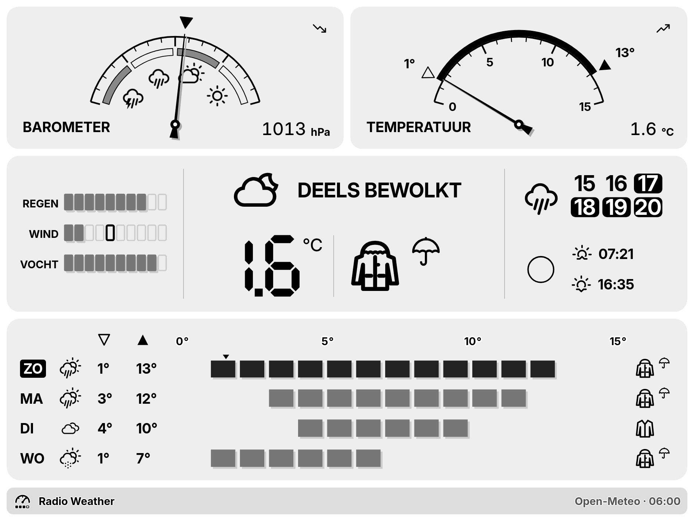

# trmnl-radio-weather-plugin

## Radio Weather



The weather as the front of an early-80s hi-fi receiver, for [TRMNL](https://trmnl.com) e-paper displays:

- **L meter**: a needle shows the temperature now, between today's low and high.
- **R meter**: a needle shows the chance of rain.
- **Smoked-glass display**: the temperature in segment digits, humidity, UV and the time the rain starts. Warning lamps light for rain, snow, hail, thunder, frost, wind and high UV.
- **Level bars**: one key per coming day with its icon, low and high.

Every element shows data. It is drawn for each view (full, half horizontal, half vertical, quadrant) and each panel: a warm lamp glow on colour screens, solid ink on BWRY, grey on the TRMNL X, and a night glass in dark mode.

### Settings

| Setting | What it does |
|---|---|
| Location | City, postal code or latitude,longitude |
| Temperature Unit | Celsius or Fahrenheit |
| Days Shown | Day keys; Auto fits the screen |
| Dial Span | How far ahead the rain meter looks |
| Hide Title Bar | Hides the title bar on the full view |
| Language | Override the TRMNL account language |

Data comes from [Open-Meteo](https://open-meteo.com); no key is needed.

## Development

Built with [trmnlp](https://github.com/usetrmnl/trmnlp).

```bash
cd plugin
trmnlp serve        # preview
trmnlp test         # RSpec specs in plugin/tests
node ../test/model/run.js   # pure-logic tests of the weather model
ruby ../tools/sync_trmnl_i18n.rb   # re-sync TRMNL's translations
```

## Licence

Copyright (c) 2026 ExcuseMi. All rights reserved. No licence is granted to copy, modify or redistribute this code.

The weather texts (the `sw_i18n` capture in each `plugin/src/<view>.liquid`, the slots between the `I18N_TRMNL` markers in `shared.liquid`) come from
[usetrmnl/trmnl-i18n](https://github.com/usetrmnl/trmnl-i18n) and stay under its MIT licence; see
[third_party/trmnl-i18n-LICENSE](third_party/trmnl-i18n-LICENSE). The weather icons are loaded from trmnl.com and are not part of this repository.

Credits: Parka icon: moncler-jacket by Delapouite, game-icons.net, CC BY 3.0, https://game-icons.net
